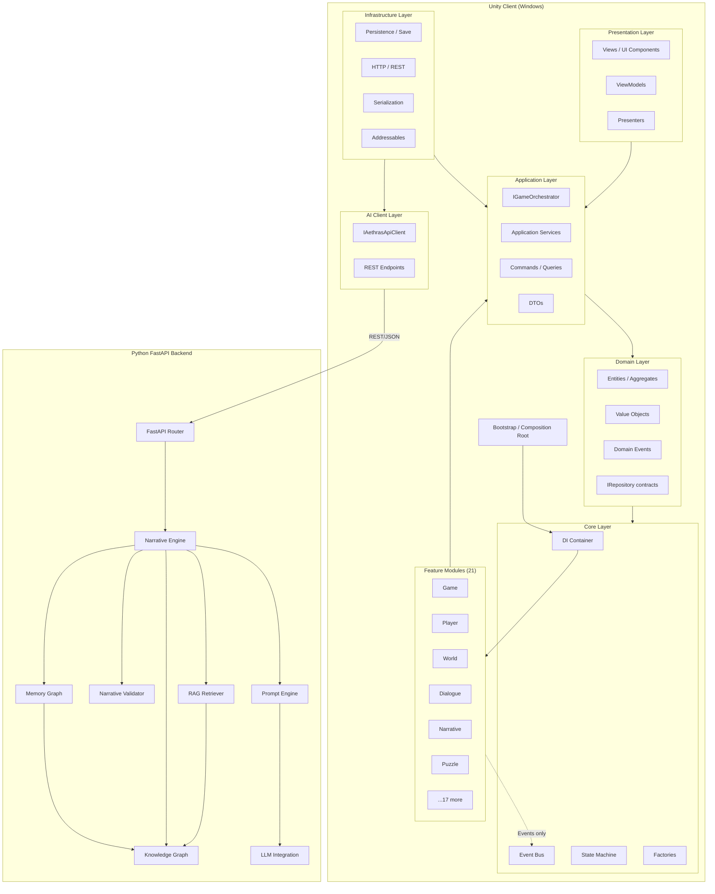
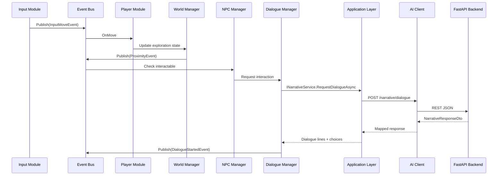
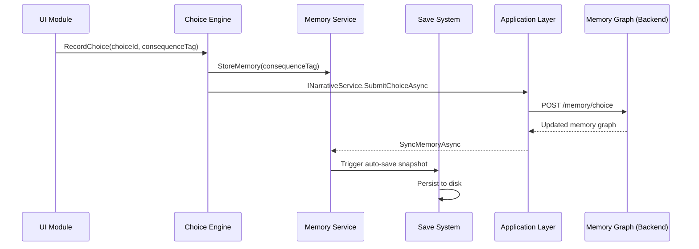
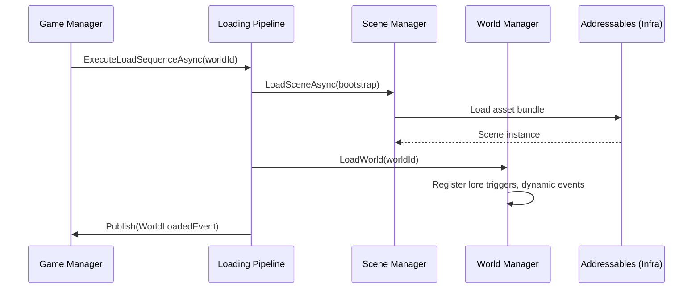
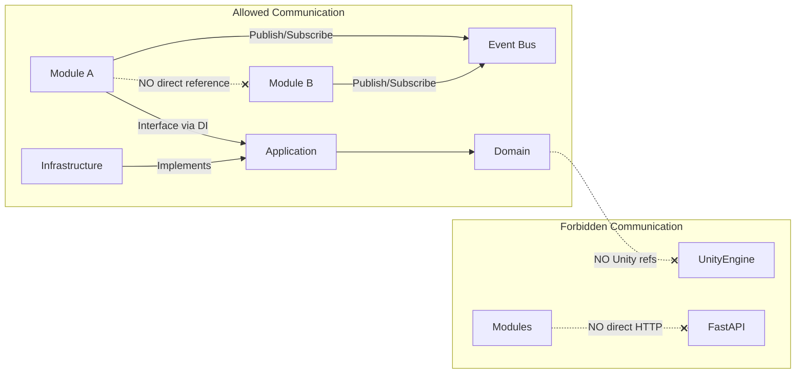
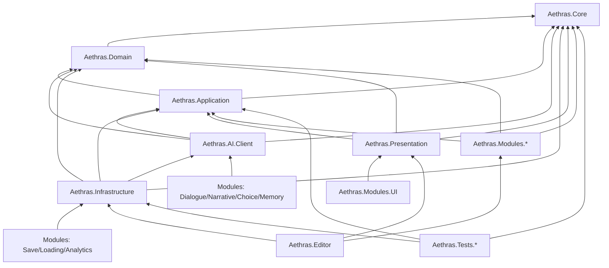
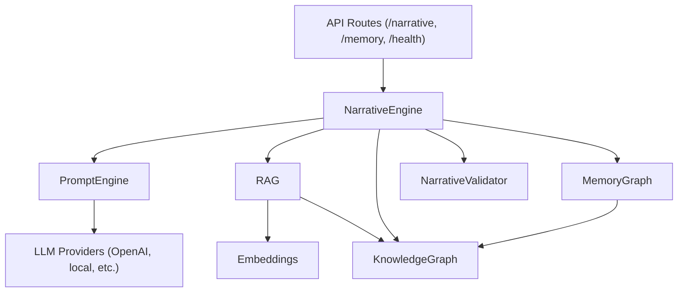

# AETHRAS: Odyssey Beyond the Veil — System Architecture

> **Engine:** Unity 6 LTS · URP · C#  
> **Backend:** Python FastAPI  
> **Target:** Windows Desktop  
> **Status:** Architecture Phase (no gameplay implementation)

---

## 1. Architectural Vision

AETHRAS is designed as a **research-grade, production-scalable** psychological horror adventure. The architecture follows **Clean Architecture** with strict layer separation, **event-driven** inter-module communication, and an **AI backend decoupled from Unity** via REST.

### Guiding Principles

| Principle | Application |
|-----------|-------------|
| **SOLID** | Single-responsibility managers; interface segregation per module |
| **DRY** | Shared Core utilities; Application DTOs; no duplicate persistence logic |
| **KISS** | Modules expose one primary service interface each |
| **Dependency Injection** | Composition root in Bootstrap; constructor injection everywhere |
| **Event Bus** | Cross-module signals; no direct module-to-module references |
| **Repository Pattern** | Domain persistence abstracted; Infrastructure implements |
| **Command Pattern** | Player actions, save/load, narrative submissions |
| **Strategy Pattern** | Puzzle types, LLM providers, validation rules |
| **State Machine** | Game flow, dialogue, puzzles, loading pipeline |
| **Observer Pattern** | Event Bus + UI ViewModels reacting to domain events |

---

## 2. System Architecture Diagram



---

## 3. Layer Responsibilities

### Core (`Aethras.Core`)
Foundation with **zero domain knowledge**. Provides DI container, Event Bus, state machine primitives, command interfaces, factories, logging utilities, and constants.

**Why it exists:** Prevents circular dependencies; shared infrastructure for all assemblies.

### Domain (`Aethras.Domain`)
Pure C# domain model: entities, value objects, enums, domain events, repository **contracts**. No UnityEngine references where avoidable.

**Why it exists:** Business rules and data shapes independent of Unity lifecycle.

### Application (`Aethras.Application`)
Use-case orchestration: `IGameOrchestrator`, `INarrativeService`, `ISaveLoadService`, commands, queries, DTOs, validators.

**Why it exists:** Coordinates workflows without UI or transport details.

### Infrastructure (`Aethras.Infrastructure`)
Technical implementations: file I/O, JSON serialization, Addressables wrappers, repository implementations, HTTP bridge to AI.Client.

**Why it exists:** Swappable persistence and networking; keeps modules testable.

### Presentation (`Aethras.Presentation`)
MVVM-style UI: Views, ViewModels, Presenters. Binds to Application services and Event Bus.

**Why it exists:** Separates rendering/input presentation from game logic.

### AI Client (`Aethras.AI.Client`)
REST client, endpoint definitions, request/response DTOs for FastAPI backend.

**Why it exists:** Isolates API contract; enables mock backend for Unity tests.

### Feature Modules (`Aethras.Modules.*`)
One assembly per gameplay system. Each module owns Controllers, Services, Interfaces, Data (ScriptableObject bindings), and Events.

**Why it exists:** Independent development, testing, and hot-swapping of features.

### Editor (`Aethras.Editor`)
Editor-only tools: custom inspectors, build pipelines, narrative authoring aids.

**Why it exists:** Keeps editor code out of player builds.

---

## 4. Data Flow

### 4.1 Exploration Loop



### 4.2 Permanent Choice Flow



### 4.3 World Load Flow



---

## 5. Communication Diagram



### Event Bus Event Categories

| Category | Examples | Publishers | Subscribers |
|----------|----------|------------|-------------|
| Input | `InputMoveEvent`, `InputInteractEvent` | Input | Player, UI |
| World | `WorldLoadedEvent`, `LoreDiscoveredEvent` | World | Narrative, Audio, UI |
| Dialogue | `DialogueStartedEvent`, `DialogueChoiceEvent` | Dialogue | Camera, UI, Choice |
| Narrative | `StoryBeatChangedEvent` | Narrative | Quest, Achievement |
| System | `GamePausedEvent`, `SaveCompletedEvent` | Game, Save | All modules |

---

## 6. Dependency Graph



### Assembly Count Summary

| Assembly | Count | Purpose |
|----------|-------|---------|
| Core layers | 6 | Core, Domain, Application, Infrastructure, Presentation, AI.Client |
| Feature modules | 21 | One per gameplay system |
| Editor | 1 | Editor tooling |
| Tests | 2 | EditMode, PlayMode |
| **Total** | **30** | |

---

## 7. Backend Architecture (Python FastAPI)



### Backend Module Responsibilities

| Module | Responsibility |
|--------|----------------|
| `narrative/engine` | Orchestrates story generation pipeline |
| `prompt/engine` | Template assembly, token budgeting |
| `prompt/templates` | Version-controlled prompt templates |
| `rag/` | Retrieval-augmented lore/context injection |
| `knowledge_graph/` | World lore, NPC relationships, causal links |
| `validator/` | Ensures AI output respects narrative rules |
| `memory_graph/` | Persistent player choice/consequence graph |
| `llm/providers` | Swappable LLM backends (Strategy pattern) |

---

## 8. Bootstrap & Composition Root

```
Bootstrap Scene
    └── GameBootstrapper (MonoBehaviour — ONLY entry point in scene)
            ├── Creates DependencyContainer
            ├── Registers Core services (EventBus, StateMachine factory)
            ├── Registers Application services
            ├── Registers Infrastructure implementations
            ├── Registers all Module services
            ├── Registers Presentation presenters
            └── Calls IGameOrchestrator.InitializeAsync()
```

**Rule:** `GameBootstrapper` is the only MonoBehaviour allowed to call `Resolve()`. All other classes receive dependencies via constructor injection.

---

## 9. ScriptableObject Strategy

| Folder | Purpose |
|--------|---------|
| `ScriptableObjects/Worlds` | World definitions, connection graph |
| `ScriptableObjects/NPCs` | NPC identity, default dialogue trees |
| `ScriptableObjects/Dialogue` | Fallback non-AI dialogue nodes |
| `ScriptableObjects/Quests` | Objectives, prerequisites, consequences |
| `ScriptableObjects/Puzzles` | Puzzle definitions, strategy type IDs |
| `ScriptableObjects/Narrative` | Story beats, lore entries |
| `ScriptableObjects/Audio` | Music/ambience catalogs |
| `ScriptableObjects/Settings` | Default settings profile |

ScriptableObjects are **data definitions only**. Runtime logic lives in Module Services.

---

## 10. Research Considerations

- **Analytics Module** captures choice distribution, session length, exploration coverage
- **Achievement Module** marks narrative milestones for study cohorts
- **Backend logs** (structured JSON) enable post-session analysis
- **ADR folder** (`docs/adr/`) documents architectural decisions for paper/reports
- **Feature flags** via Settings enable A/B narrative experiments

---

## Related Documents

- [FOLDER_STRUCTURE.md](./FOLDER_STRUCTURE.md) — Complete directory tree with rationale
- [NAMESPACES.md](./NAMESPACES.md) — Namespace conventions
- [ASSEMBLY_DEFINITIONS.md](./ASSEMBLY_DEFINITIONS.md) — Asmdef reference
- [DEPENDENCY_GRAPH.md](./DEPENDENCY_GRAPH.md) — Detailed dependency rules
- [DATA_FLOW.md](./DATA_FLOW.md) — Extended flow documentation
- [COMMUNICATION.md](./COMMUNICATION.md) — Event catalog and API contracts
- [GIT_STRUCTURE.md](./GIT_STRUCTURE.md) — Repository layout
- [../modules/MODULES.md](../modules/MODULES.md) — Per-module responsibilities
