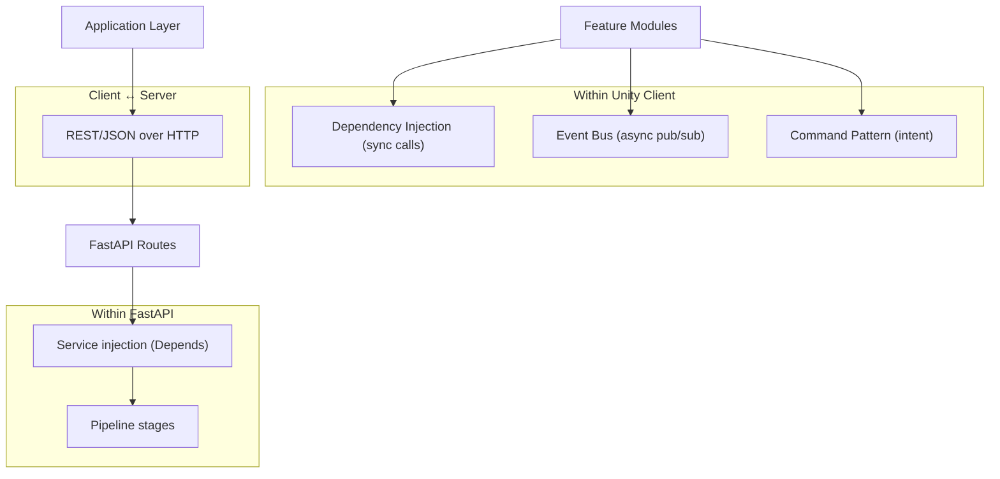
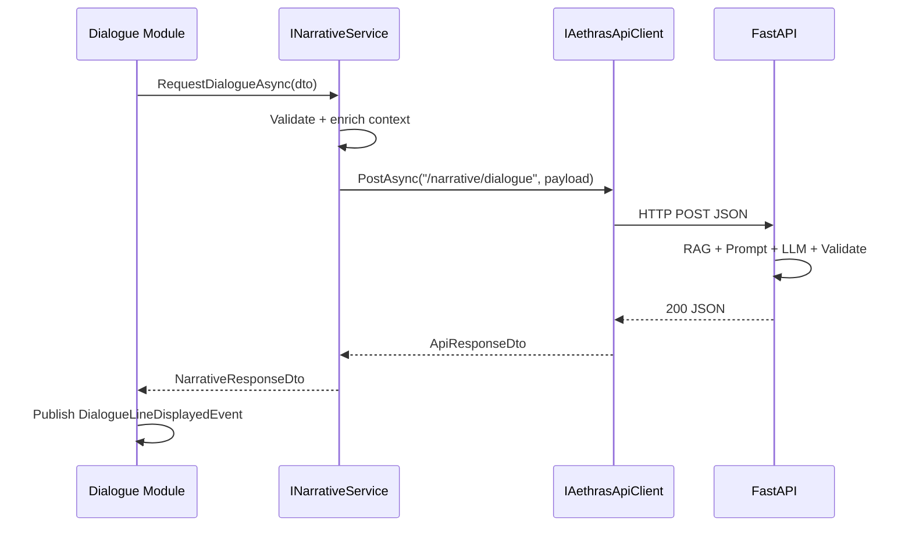

# Communication Patterns

How systems communicate in AETHRAS — events, DI, REST, and forbidden patterns.

---

## 1. Communication Channels



---

## 2. Event Bus Contract

### Core Rules
- Events are **`struct`** value types (zero allocation pressure)
- Events are **immutable** (init-only or readonly fields)
- Handlers must be **idempotent** where possible
- No event handler may block on network I/O — defer to async services

### Event Naming Convention
```
{Domain}{Action}Event
```
Examples: `DialogueStartedEvent`, `WorldLoadedEvent`, `ChoiceRecordedEvent`

### Core System Events

| Event | Publisher | Subscribers | Payload |
|-------|-----------|-------------|---------|
| `GameInitializedEvent` | Game | All modules | SessionId |
| `GamePausedEvent` | Game | Input, Audio, UI | — |
| `GameResumedEvent` | Game | Input, Audio, UI | — |
| `SaveRequestedEvent` | Save | Game | SlotId, IsAuto |
| `SaveCompletedEvent` | Save | UI, Analytics | SlotId, Success |

### Input Events

| Event | Publisher | Subscribers |
|-------|-----------|-------------|
| `InputMoveEvent` | Input | Player, Analytics |
| `InputInteractEvent` | Input | Player |
| `InputPauseEvent` | Input | Game |
| `InputMenuEvent` | Input | UI |

### World & Exploration Events

| Event | Publisher | Subscribers |
|-------|-----------|-------------|
| `WorldLoadedEvent` | World | NPC, Audio, Narrative, Quest |
| `WorldUnloadedEvent` | World | Scene, NPC |
| `LoreDiscoveredEvent` | World | Narrative, Achievement, Analytics |
| `ProximityEnteredEvent` | World | NPC, UI |
| `DynamicEventTriggeredEvent` | World | Narrative, Audio |

### Dialogue & Narrative Events

| Event | Publisher | Subscribers |
|-------|-----------|-------------|
| `DialogueStartedEvent` | Dialogue | Camera, UI, Input |
| `DialogueLineDisplayedEvent` | Dialogue | UI, Audio |
| `DialogueChoicePresentedEvent` | Dialogue | UI |
| `DialogueEndedEvent` | Dialogue | Camera, Input, Quest |
| `StoryBeatChangedEvent` | Narrative | Quest, Achievement, UI |

### Choice & Memory Events

| Event | Publisher | Subscribers |
|-------|-----------|-------------|
| `ChoiceRecordedEvent` | Choice | Memory, Quest, Analytics |
| `ConsequenceAppliedEvent` | Choice | World, Narrative |
| `MemoryUpdatedEvent` | Memory | Save, Narrative |
| `MemorySyncedEvent` | Memory | UI |

### Puzzle Events

| Event | Publisher | Subscribers |
|-------|-----------|-------------|
| `PuzzleStartedEvent` | Puzzle | Camera, UI, Input, Game |
| `PuzzleCompletedEvent` | Puzzle | Quest, Achievement, Game |
| `PuzzleFailedEvent` | Puzzle | Audio, UI |

---

## 3. REST API Communication

### Base URL
```
http://{host}:{port}/api/v1
```

### Endpoints (Contract — implementation in next phase)

| Method | Endpoint | Purpose | Request | Response |
|--------|----------|---------|---------|----------|
| GET | `/health` | Backend health check | — | `{ "status": "ok" }` |
| POST | `/narrative/dialogue` | Generate NPC dialogue | `NarrativeRequest` | `NarrativeResponse` |
| POST | `/narrative/environment` | Environmental narrative | `NarrativeRequest` | `NarrativeResponse` |
| POST | `/memory/choice` | Record permanent choice | `ChoiceSubmission` | `{ "success": bool }` |
| POST | `/memory/sync` | Sync memory graph | `MemorySyncRequest` | `MemorySyncResult` |
| GET | `/memory/{sessionId}` | Retrieve memory state | — | `MemoryState` |
| POST | `/rag/query` | Direct lore retrieval (debug) | `RagQuery` | `RagResult` |

### Communication Sequence (Dialogue)



### Error Handling Protocol

| HTTP Code | Client Action |
|-----------|---------------|
| 200 | Process response |
| 400 | Log validation error; use fallback dialogue |
| 503 | Retry with exponential backoff (max 3) |
| Timeout | Offline fallback mode; queue choice for later sync |

---

## 4. Command Pattern Communication

Commands represent **intent**; handlers perform **side effects**.

| Command | Handler | Module |
|---------|---------|--------|
| `SaveGameCommand` | `SaveGameCommandHandler` | Save |
| `LoadGameCommand` | `LoadGameCommandHandler` | Save |
| `SubmitChoiceCommand` | `SubmitChoiceCommandHandler` | Choice |
| `StartDialogueCommand` | `StartDialogueCommandHandler` | Dialogue |
| `LoadWorldCommand` | `LoadWorldCommandHandler` | World |
| `StartPuzzleCommand` | `StartPuzzleCommandHandler` | Puzzle |

Commands are dispatched via `ICommandHandler<T>` registered in DI — not via Event Bus.

**When to use Commands vs Events:**
- **Command:** One handler, intentional side effect, returns success/failure
- **Event:** Zero or many subscribers, notification only, no return value

---

## 5. Observer Pattern (UI)

Presentation layer ViewModels subscribe to Event Bus:

```
DialogueViewModel subscribes to:
  - DialogueStartedEvent
  - DialogueLineDisplayedEvent
  - DialogueChoicePresentedEvent
  - DialogueEndedEvent

LoadingViewModel subscribes to:
  - LoadingProgressEvent (from Loading Pipeline)
  - WorldLoadedEvent
```

ViewModels never call module services directly for reads — they observe events and query Application services for state.

---

## 6. Forbidden Communication Patterns

| Pattern | Why Forbidden | Alternative |
|---------|---------------|-------------|
| `DialogueManager` referencing `QuestManager` | Tight coupling | `ChoiceRecordedEvent` → Quest subscribes |
| Module calling `HttpClient` directly | Bypasses validation | `INarrativeService` |
| Static singleton managers | Untestable, hidden deps | DI + interfaces |
| `FindObjectOfType<T>()` | Service locator anti-pattern | Constructor injection |
| Domain entity referencing MonoBehaviour | Layer violation | Controller holds entity ref |
| Backend sharing Unity DLLs | Platform mismatch | REST + JSON DTOs |

---

## 7. Backend Internal Communication

FastAPI services use **dependency injection** (`Depends()`):

```python
# Conceptual flow (implementation in next phase)
Router → NarrativeService → NarrativeEngine
                              ├── PromptEngine
                              ├── RagRetriever
                              ├── MemoryGraph
                              ├── KnowledgeGraph
                              └── NarrativeValidator
```

Each backend module exposes an ABC interface (`interfaces/`) with a single default implementation — mirrors Unity's interface pattern.
