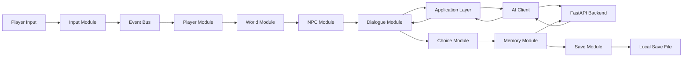
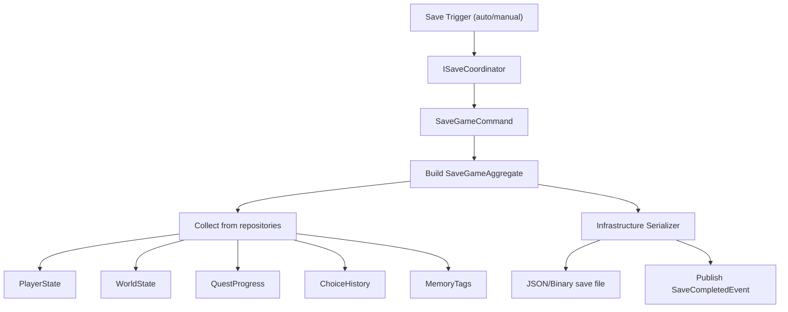
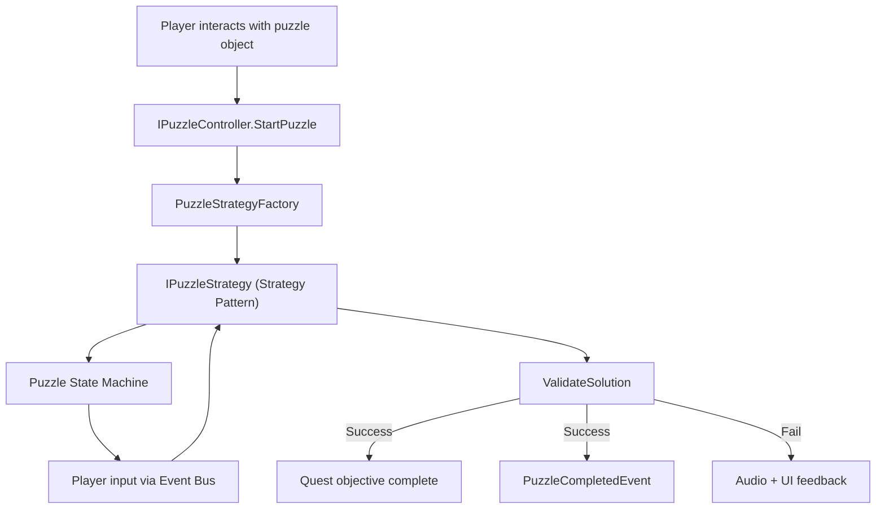

# Data Flow Documentation

Extended data flow patterns for AETHRAS systems.

---

## 1. Master Data Flow Overview

---

## 2. Input → Action Pipeline

| Step | Component | Data Shape | Direction |
|------|-----------|------------|-----------|
| 1 | Unity Input System | Raw device state | Hardware → Input Module |
| 2 | `IInputService` | Normalized actions | Input → Event Bus |
| 3 | Event Bus | `InputInteractEvent` | Pub/Sub |
| 4 | `IPlayerController` | Interaction raycast | Player Module |
| 5 | Event Bus | `InteractionTriggeredEvent` | Pub/Sub |
| 6 | `INpcManager` / World triggers | Entity ID | NPC/World Module |

**Design note:** Input never calls Dialogue or UI directly. All routing goes through events.

---

## 3. Narrative Request Pipeline

| Step | Layer | Operation | Payload |
|------|-------|-----------|---------|
| 1 | Dialogue Module | Build context | `npcId`, `worldId`, player text |
| 2 | Application | Map to DTO | `NarrativeRequestDto` |
| 3 | Application | Validate | Session/world guards |
| 4 | AI Client | POST `/api/v1/narrative/dialogue` | JSON body |
| 5 | Backend | RAG retrieval | Lore chunks from Knowledge Graph |
| 6 | Backend | Prompt assembly | Template + context + memory |
| 7 | Backend | LLM inference | Generated text |
| 8 | Backend | Validator | Rule check against canon |
| 9 | AI Client | Deserialize | `ApiResponseDto<NarrativeResponseDto>` |
| 10 | Application | Map response | `NarrativeResponseDto` |
| 11 | Dialogue Module | Render lines | UI via Event Bus |

---

## 4. Save Game Data Flow

### Save Aggregate Contents

| Domain Entity | Source Module | Persisted Fields |
|---------------|---------------|------------------|
| `PlayerState` | Player | Position, world ID, exploration flags |
| `WorldState` | World | Loaded worlds, triggered events |
| `QuestProgress` | Quest | Active/completed quests, objectives |
| `ChoiceHistory` | Choice | Permanent choice IDs, consequence tags |
| `MemorySnapshot` | Memory | Active memory tags (synced with backend) |
| `NarrativeProgress` | Narrative | Story beats, discovered lore |
| `InventoryState` | Inventory | Item IDs |
| `SettingsSnapshot` | Settings | Non-system preferences |

---

## 5. World Transition Data Flow

| Phase | System | Action |
|-------|--------|--------|
| Pre-load | Game State Machine | Enter `Loading` state |
| Pre-load | Input Module | Disable input |
| Load | Loading Pipeline | Show progress UI |
| Load | Scene Manager | Unload previous additive scenes |
| Load | Addressables | Load world scene bundle |
| Init | World Manager | Apply saved world state |
| Init | NPC Manager | Spawn NPCs from saved state |
| Init | Quest Manager | Restore active quests |
| Post-load | Memory Service | Apply cross-world consequence filters |
| Post-load | Event Bus | `WorldLoadedEvent` |
| Post-load | Game State Machine | Enter `Exploration` state |

---

## 6. Puzzle Data Flow

---

## 7. Analytics Data Flow (Research)

| Event Source | Analytics Event | Properties |
|--------------|-----------------|------------|
| Choice Engine | `choice_made` | choiceId, worldId, timestamp |
| World Manager | `world_entered` | worldId, sessionTime |
| Narrative | `lore_discovered` | loreId, worldId |
| Dialogue | `dialogue_session_end` | npcId, duration, aiGenerated |
| Game | `session_start/end` | sessionId, cohortId |

Analytics batches locally → flushes to research endpoint (Infrastructure) on session end.

---

## 8. Error & Fallback Data Flow

| Failure | Handler | Fallback |
|---------|---------|----------|
| Backend unreachable | AI Client | Cached fallback dialogue ScriptableObject |
| Validator rejects AI output | Backend | Retry with constrained prompt |
| Save write failure | Infrastructure | Retry + user notification via UI |
| Addressables load fail | Loading Pipeline | Abort load, return to main menu |

---

## 9. DTO Boundary Map

| Boundary | Client Type | Server Type | Owner |
|----------|-------------|-------------|-------|
| Unity Module ↔ Application | Domain entities | — | Domain |
| Application ↔ AI Client | `NarrativeRequestDto` | — | Application |
| AI Client ↔ FastAPI | `ApiResponseDto<T>` | Pydantic schemas | Shared spec in `docs/api/` |
| Application ↔ Infrastructure | Domain aggregates | — | Domain |

**Rule:** DTOs never cross more than one boundary without mapping.
