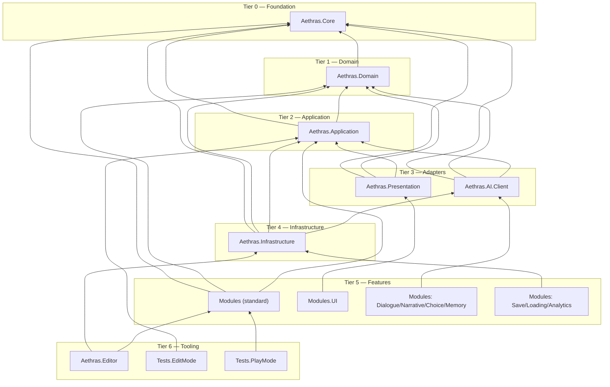
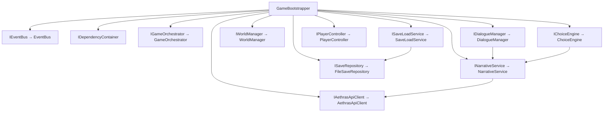
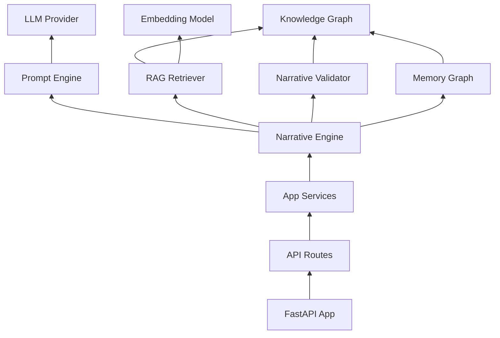

# Dependency Graph

Detailed compile-time and runtime dependency rules for AETHRAS.

---

## Compile-Time Dependency Graph

---

## Runtime Dependency Graph (DI)

At runtime, the **Composition Root** (`GameBootstrapper`) wires interfaces to implementations:

---

## Module Interaction Matrix

Rows = consumer, Columns = provider.  
✅ = via interface/DI, 📡 = via Event Bus only, ❌ = forbidden

| Consumer ↓ / Provider → | Player | World | Dialogue | Choice | Save | Narrative | UI | Game |
|-------------------------|--------|-------|----------|--------|------|-----------|-----|------|
| Player | — | 📡 | ❌ | ❌ | ❌ | ❌ | ❌ | 📡 |
| World | 📡 | — | 📡 | ❌ | ❌ | 📡 | ❌ | 📡 |
| Dialogue | ❌ | ❌ | — | 📡 | ❌ | ✅ App | 📡 | 📡 |
| Choice | ❌ | 📡 | 📡 | — | 📡 | ✅ App | ❌ | 📡 |
| Save | ❌ | ❌ | ❌ | ❌ | — | ❌ | ❌ | 📡 |
| UI | ❌ | ❌ | 📡 | ❌ | ❌ | ❌ | — | 📡 |
| Game | ✅ DI | ✅ DI | ✅ DI | ❌ | ✅ DI | ❌ | ✅ DI | — |

**Key:** `Game` module (orchestrator) is the only module permitted to directly inject multiple module interfaces — it acts as the high-level coordinator via `IGameOrchestrator`.

---

## Backend Dependency Graph

---

## Circular Dependency Prevention

| Risk | Prevention |
|------|------------|
| Module A ↔ Module B | Event Bus only |
| Domain ↔ Application | Strict one-way: App depends on Domain |
| Unity ↔ Domain | Domain entities avoid MonoBehaviour |
| Client ↔ Server types | Separate DTOs; shared OpenAPI spec in `docs/api/` |
| Narrative ↔ Dialogue | Both use Application `INarrativeService` |

---

## Service Locator Policy

**Default:** Constructor injection via `IDependencyContainer` at bootstrap.

**Service Locator permitted only for:**
- `GameBootstrapper` (composition root)
- Editor tooling (optional `EditorServiceLocator` in `Aethras.Editor`)
- Unity serialization callbacks where DI is unavailable (document with ADR)

**Never use Service Locator in:** Module Services, Application Services, Domain logic.
