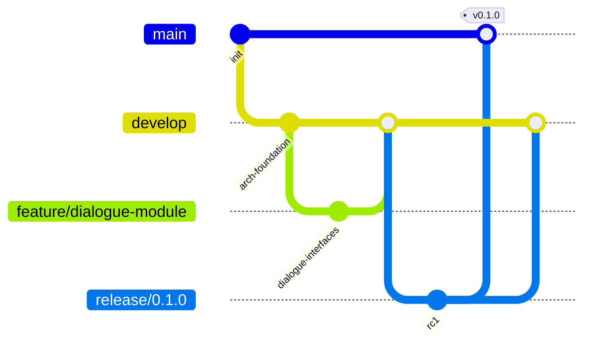

# Git Repository Structure

Recommended monorepo layout for AETHRAS development, CI, and research reproducibility.

---

## Repository Layout

```
AETHRAS/                                    # Git root (github.com/org/aethras-odyssey)
│
├── .github/
│   ├── workflows/
│   │   ├── unity-build.yml                 # Windows standalone build
│   │   ├── unity-test-editmode.yml         # EditMode unit tests
│   │   ├── backend-test.yml                # pytest + lint
│   │   └── backend-deploy.yml              # Optional staging deploy
│   ├── ISSUE_TEMPLATE/
│   │   ├── bug_report.md
│   │   └── feature_request.md
│   └── PULL_REQUEST_TEMPLATE.md
│
├── .gitignore                              # Unity + Python + OS ignores
├── .gitattributes                          # LFS patterns for art assets
├── LICENSE
├── README.md                               # Project overview, setup instructions
├── CHANGELOG.md                            # Release notes
├── CONTRIBUTING.md                         # Branch strategy, code standards
│
├── client/                                 # Unity project (subtree or root folder)
│   └── AethrasOdyssey/
│       ├── Assets/_Project/                # Tracked: all project assets & scripts
│       ├── Packages/manifest.json          # Tracked: UPM dependencies
│       └── ProjectSettings/                # Tracked: project config
│
├── server/                                 # Python backend
│   └── aethras_backend/
│       ├── app/                            # Tracked: application code
│       ├── tests/                          # Tracked: test suite
│       ├── pyproject.toml                  # Tracked: project metadata
│       ├── requirements.txt                # Tracked: pinned dependencies
│       └── requirements-dev.txt            # Tracked: dev/test dependencies
│
├── docs/                                   # Tracked: all documentation
│   ├── architecture/
│   ├── modules/
│   ├── api/
│   │   └── openapi.yaml                    # Shared API contract
│   ├── research/
│   └── adr/
│       └── 0001-monorepo-structure.md
│
└── tools/                                  # Tracked: build & dev scripts
    ├── build/
    │   └── build_windows.ps1
    ├── ci/
    └── scripts/
        └── start_mock_backend.ps1
```

---

## Git LFS Configuration

Large binary assets should use Git LFS:

```gitattributes
# .gitattributes
*.fbx filter=lfs diff=lfs merge=lfs -text
*.obj filter=lfs diff=lfs merge=lfs -text
*.blend filter=lfs diff=lfs merge=lfs -text
*.psd filter=lfs diff=lfs merge=lfs -text
*.wav filter=lfs diff=lfs merge=lfs -text
*.mp3 filter=lfs diff=lfs merge=lfs -text
*.ogg filter=lfs diff=lfs merge=lfs -text
*.png filter=lfs diff=lfs merge=lfs -text
*.exr filter=lfs diff=lfs merge=lfs -text
*.tga filter=lfs diff=lfs merge=lfs -text
*.cubemap filter=lfs diff=lfs merge=lfs -text
```

**Why LFS:** Keeps repo clone fast; art team works with large assets without bloating git history.

---

## Branch Strategy



| Branch | Purpose | Merge Target |
|--------|---------|--------------|
| `main` | Production-ready releases | — |
| `develop` | Integration branch | `main` (releases) |
| `feature/*` | Feature development | `develop` |
| `fix/*` | Bug fixes | `develop` or `main` (hotfix) |
| `release/*` | Release candidates | `main` + `develop` |
| `research/*` | Experimental study branches | `develop` (if validated) |

---

## Commit Convention

Use [Conventional Commits](https://www.conventionalcommits.org/):

```
{type}({scope}): {description}

[optional body]
```

| Type | Usage |
|------|-------|
| `feat` | New feature |
| `fix` | Bug fix |
| `arch` | Architecture/structure changes |
| `docs` | Documentation only |
| `test` | Tests |
| `refactor` | Code refactor |
| `ci` | CI/CD changes |

**Scopes:** `client`, `server`, `dialogue`, `world`, `ai`, `docs`, etc.

**Examples:**
```
arch(client): add Aethras.Modules.Puzzle assembly definition
feat(server): add narrative dialogue endpoint schema
docs(architecture): document event bus contract
```

---

## CI Pipeline Overview

| Workflow | Trigger | Actions |
|----------|---------|---------|
| `unity-build.yml` | Push to `develop`, `main` | Build Windows standalone |
| `unity-test-editmode.yml` | PR to `develop` | Run EditMode tests |
| `backend-test.yml` | Push/PR affecting `server/` | pytest, ruff, mypy |
| `backend-deploy.yml` | Tag `v*` | Deploy to staging |

---

## Environment & Secrets

| Secret | Location | Used By |
|--------|----------|---------|
| `LLM_API_KEY` | Server env / GitHub Secrets | Backend LLM provider |
| `UNITY_LICENSE` | GitHub Secrets | CI Unity build |
| Backend URL | Client ScriptableObject config | Unity AI Client |

**Never commit:** `.env`, API keys, `credentials.json`, local save files.

---

## Research Reproducibility

For study publications, tag releases with:

```
v{major}.{minor}.{patch}-study.{cohortId}
```

Example: `v0.3.0-study.cohort-a`

Each study tag should have:
- Locked `requirements.txt` hash
- Unity build artifact
- `docs/research/cohort-a-protocol.md`
- Backend knowledge graph snapshot in `server/aethras_backend/data/knowledge/`

---

## Submodule Alternative (Not Recommended)

AETHRAS uses **monorepo** over submodules because:
- API contract changes require atomic client+server commits
- Research reproducibility needs single checkout
- Simpler CI orchestration

If backend must deploy independently later, extract `server/` to its own repo with shared OpenAPI package.
